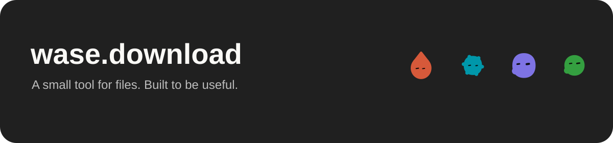

### Building useful tools with open source

I work on Wase products: small interfaces, self-hosted infrastructure and software people can actually use.

**[wase.download](https://wase.download)** — a multilingual file converter. Images, documents, books, audio, video, archives, presentations, fonts, vectors and CAD/3D. Browser processing for images; isolated server jobs for broader formats.

[Try the converter](https://wase.download) · [Source](https://github.com/vlad1337vlad1337-droid/wase-download) · [Supported formats](https://wase.download/en/formats/) · [Developer guide](https://wase.download/en/developers/)

| Repository | Purpose |
| --- | --- |
| [wase-download](https://github.com/vlad1337vlad1337-droid/wase-download) | Interface, browser conversion, static multilingual pages and tests |
| [wase-converter-engine](https://github.com/vlad1337vlad1337-droid/wase-converter-engine) | Self-hosted conversion engine and bounded server adapter |

Built on ImageTracer, ConvertX, VTracer, Blobatar and other open-source projects. Upstream authors, source and licenses are credited in each repository. Capabilities are documented honestly; declared format support is not a guarantee for every arbitrary file.
