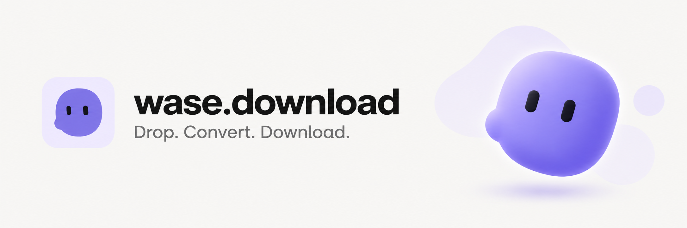

<a href="https://wase.download">Try Wase Download</a> · <a href="https://github.com/vlad1337vlad1337-droid/wase-download">Explore the source</a> · <a href="https://dalink.to/wase_download">Buy me a coffee</a>

### Wase — practical tools, open source

I build Wase products with compact interfaces and self-hosted infrastructure.

**[Wase Download](https://wase.download)** converts images, documents, ebooks, audio, video, archives, presentations, fonts, vectors and CAD/3D files in **13 languages**. Images can be processed in the browser; broader formats use isolated server jobs. No account is required.

[Supported formats](https://wase.download/en/formats/) · [Developer guide](https://wase.download/en/developers/) · [Privacy](https://wase.download/en/privacy/)

| Project | What you will find |
| --- | --- |
| [Wase Download](https://github.com/vlad1337vlad1337-droid/wase-download) | Converter interface, browser image tools, localized pages and tests |
| [Wase converter engine](https://github.com/vlad1337vlad1337-droid/wase-converter-engine) | ConvertX fork with isolated jobs and resource limits |
| [Wase Connect downloads](https://github.com/vlad1337vlad1337-droid/wase-connect-downloads) | Downloads, installation guides and release status |
| [KidsGames](https://github.com/vlad1337vlad1337-droid/kidsgames) | Multiplayer framework and game-engine SDKs |

**Join in:** try the converter, [report bugs or suggest improvements](https://github.com/vlad1337vlad1337-droid/wase-download/issues), or contribute a pull request. Start with the [contribution guide](https://github.com/vlad1337vlad1337-droid/wase-download/blob/master/CONTRIBUTING.md). If it is useful, a GitHub star helps people discover the project.

**Support development:** [Buy me a coffee](https://dalink.to/wase_download). Donations help with hosting and development and are optional; Wase Download is free to use.

Built with ImageTracer, ConvertX, VTracer, Blobatar and other open-source projects. Upstream authors and licenses are credited in the repositories; [banner and mascot notices](assets/NOTICES.md) are retained here.
